# Лаба 2 - Docker

### Небольшой дисклеймер

Всё было сделано впервые, все совпадения персонажей с реальными людьми случайны, простите за использование винды. 🥲


## Установка Docker

Для использования докера на Windows необходима установка Docker Desktop, так как контейнеризация не встроена в ядро. Поэтому качаем его с [официального сайта](https://www.docker.com/products/docker-desktop/).

Проверяем, что у нас все хорошо, выводим версию.

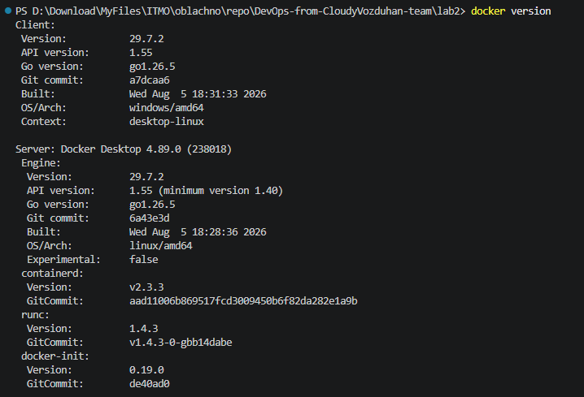


## Пишем образы

### Guilty pleasure
---

Создаем образ, как делать НЕ надо. Образ находится в файле Dockerfile.guilty.pleasure.

```
FROM python:latest
WORKDIR /app
COPY . .
RUN pip install -r requirements.txt
ENV DATABASE_URL=postgresql://ben:ben@db:5432/ben_db
CMD ["python", "-m", "uvicorn", "backend.api:app", "--host", "0.0.0.0", "--port", "8000"]
```

### Best practices
---

А теперь как делают все крутые девопсы (наверно).

```FROM python:3.11-slim AS builder
WORKDIR /build
COPY requirements.txt .
RUN pip install --no-cache-dir --prefix=/install -r requirements.txt

FROM python:3.11-slim
RUN useradd --create-home --shell /bin/bash ben
COPY --from=builder /install /usr/local

USER ben
WORKDIR /home/ben/app
COPY --chown=ben:ben backend ./backend
COPY --chown=ben:ben scripts ./scripts
RUN chmod +x scripts/entrypoint.sh
ENV PYTHONUNBUFFERED=1
EXPOSE 8000

HEALTHCHECK --interval=15s --timeout=5s --start-period=20s --retries=5 \
  CMD python -c "import urllib.request,sys; sys.exit(0 if urllib.request.urlopen('http://localhost:8000/api/health').status==200 else 1)"


ENTRYPOINT ["./scripts/entrypoint.sh"]
```

Вспомогательный файл entrypoint.sh c проверкой на живость бд, инициализацией бд и запуском сервера.

```#!/usr/bin/env bash
set -e

python - <<'PY'
import time, os, psycopg2
url = os.environ.get("DATABASE_URL", "postgresql://admin:admin123@db:5432/ben_db")
for i in range(30):
    try:
        conn = psycopg2.connect(url)
        conn.close()
        print("База данных подключена")
        break
    except psycopg2.OperationalError:
        print(f"БД не готова, ждем")
        time.sleep(1)
else:
    print("База данных не поднялась")
    exit(1)
PY

echo "Инициализация БД"

python -m backend.db_creator
python -m backend.db_auth
python -m backend.init_admin

echo "Запуск сервера"

exec python -m uvicorn backend.api:app --host 0.0.0.0 --port 8000
```


### Сравнение и "как надо делать"
---

1. Указываем конкретную версию python, чтобы сборка всегда была предсказуемой, зависимости не нарушались из-за несовместимости новых версий. 

2. Используем multi-stage-build. Сначала загружаем билдер, который устанавливает все зависимости из requirements.txt в директорию /install, а уже вторым этапом собираем финальный образ, используя только зависимости в директории /install без лишних файлов загрузки, компиляторов, логов, которые остались в билдере. В докерфайлах финильным считается только последний из промежуточных образов.

3. Чем чаще слой меняется, тем ниже он должен объявляться. Если содержимое слоя и его предшественников не изменилось, то докер берет его из кеша. В первом варианте мы копируем весь проект перед установкой зависимостей. Соответственно, любое изменение в проекте приводит к повторной загрузке зависимостей, которые меняются не так часто, но требуют много времени для обновления. Поэтому во втором варианте копируем только файл зависимостей, так как в нем изменения происходят гораздо реже.

4. Работа от корневого пользователя и чем это чревато. Если произойдет взлом приложения, то злоумышленник получит полный доступ к системе, если контейнер работает от root. Правильной практикой является создание пользователя, от имени которого будут запускаться все процессы, так как его права ограничены домашней папкой и рабочим каталогом.

5. Использование .dockerignore. В первом варианте копируется весь проект и это плохо тем, что в образ притягиваются окружение, системные папки и файлы конфигурации с секретами и логами. Во втором варианте копируются только нужные папки без засорения контейнера и угрозы потери секретных данных.

6. Использование HEALTHCHECK. Во втором варианте мы каждые 15 секунд проверяем, отвечает ли сервер. По истечении трех попыток контейнер помечается сомнительным, и compose может перезапустить его (рассмотрим в звездочке).

7. Использование PYTHONBUFFERED. Благодаря этой переменной мы отключаем буфферизацию совсем и каждая строка лога сразу попадает в файлы логов, а не буфферизуется в stdout и переносятся в файлы только после переполнения буффера. Это поможет отслеживать логи в реальном времени и не потерять логи при падении контейнера.

8. Запуск сервиса. В первом варианте мы запускаем сервер сразу. Если бд не успела подняться, то приложение упадет с ошибкой. Поэтому во втором варианте для запуска напишем отдельный скрипт с ожиданием запуска бд, потом с ее инициализацией и только потом с запуском сервера.

## docker-compose.yaml

Содержимое прекраснейшего файла:

```
services:
  db:
    image: postgres:14
    environment:
      POSTGRES_USER: admin
      POSTGRES_PASSWORD: admin123
      POSTGRES_DB: ben_db
    volumes:
      - ben_pgdata:/var/lib/postgresql/data
    networks:
      - backend-net
    healthcheck:
      test: ["CMD-SHELL", "pg_isready -U admin -d ben_db"]
      interval: 5s
      timeout: 3s
      retries: 10
      start_period: 10s
    restart: unless-stopped
    deploy:
      resources:
        limits:
          cpus: '0.5'
          memory: 256M

  backend:
    build:
      context: .
      dockerfile: Dockerfile.best.practices
    environment:
      DATABASE_URL: postgresql://admin:admin123@db:5432/ben_db
    networks:
      - backend-net
      - frontend-net
    depends_on:
      db:
        condition: service_healthy
    restart: unless-stopped
    deploy:
      resources:
        limits:
          cpus: '0.5'
          memory: 256M

  frontend:
    image: nginx:1.25-alpine
    volumes:
      - ./frontend:/usr/share/nginx/html:ro
      - ./nginx/nginx.conf:/etc/nginx/conf.d/default.conf:ro
    ports:
      - "8080:80"
    networks:
      - frontend-net
    depends_on:
      - backend
    restart: unless-stopped 

volumes:
  ben_pgdata:

networks:
  frontend-net:
    driver: bridge
  backend-net:
    driver: bridge
    internal: true
```

### Что вообще происходит...

В общих чертах: описываем три контейнера, создаем тома для хранения данных и сети для связи контейнеров. 

Для контейнера с базой данных:

    Берем готовый образ с Docker Hub, указываем обязательные переменные окружения, указываем том для хранения данных вне контейнера, сеть (в которой бд будет видеть другие контейнеры, и другие контейнеры будут видеть контейнер бд), healthcheck для проверки контейнера, рестарт соответственно (пока не остановить процесс вручную) и ограничения по ресурсам.

Для контейнера с бекэндом:

    Здесь мы говорим, что берем свой собственный образ и собираем его. В depends_on указываем зависимость от запуска бд (запуск бэка только после запуска бд). Остальное аналогично контейнеру с бд.

Для контейнера с фронтом:

    Аналогично предыдущим контейнерам. В ports указываем проброс портов от хоста к контейнеру. 

Томы:

    Объявляем именованный том ben_pgdata. Необходим для хранения данных, которые останутся нетронутыми при удалении контейнеров. Его же указываем для контейнера бд, чтобы бд знала, куда складировать данные. 

Сети:

    Объявляем две сети для фронта и бэка. Параметр internal делает сеть изолированной от внешнего мира. Соответственно, доступ у бд есть только к бэку, у бэка есть доступ к бд и к фронту, у фронта есть доступ к бэку и в интернет. 

## Теперь самое страшное...

Проверим всё, что наделали.

```docker compose up -d --build```

Запускаем всё, что есть. Видим собраный образ и три контейнера.

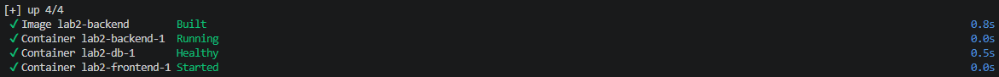


Проверим, что все контейнеры работают. Видим, что все три контейнера в живом состоянии, супер. 

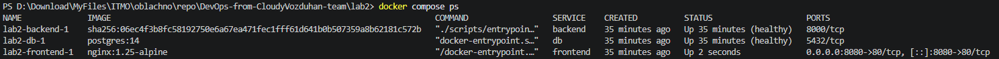

Проверка возвращает живость сервера.

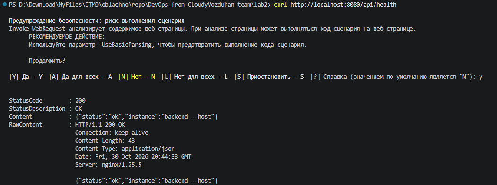

Перейдем на сайт и войдем в аккаунт, видим, что все работает.

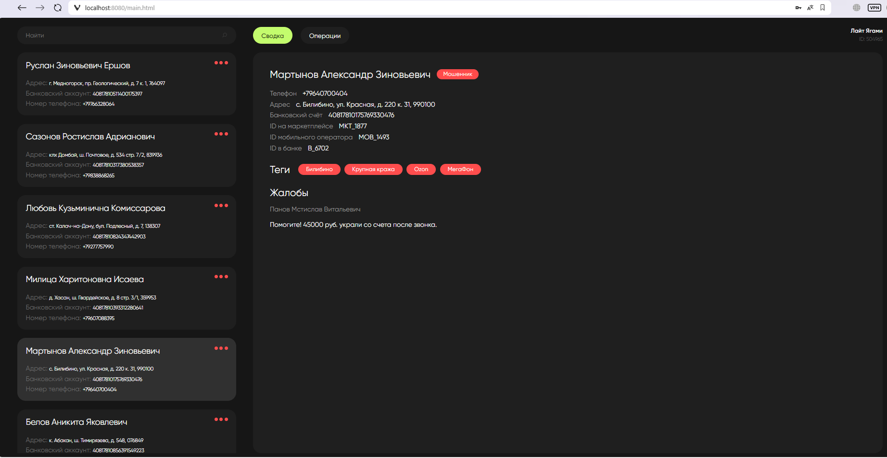

Пользователь должен быть не root из соображений безопасности, так и есть.

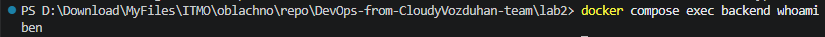

Фронт не знает о существовании бд.

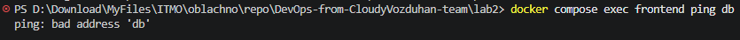

Бэк видит бд.

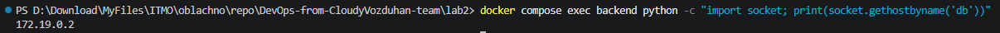

Сравним размеры хорошего и плохого образов. Видим, что плохой образ весит 2.01 Гб, а хороший 486 Мб. 

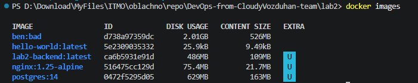

Теперь посмотрим на время пересборки. Удалим весь кеш и замерим время пересборки. Сначала для хорошего образа: первая пересборка заняла 25 секунд, после этого в один из файлов проекта были внесены правки, а потом снова замерили время пересборки, оно составило всего 1.3 секунды. Повторим те же действия с плохим образом и видим, что обе сборки заняли примерно 25 секунд. 

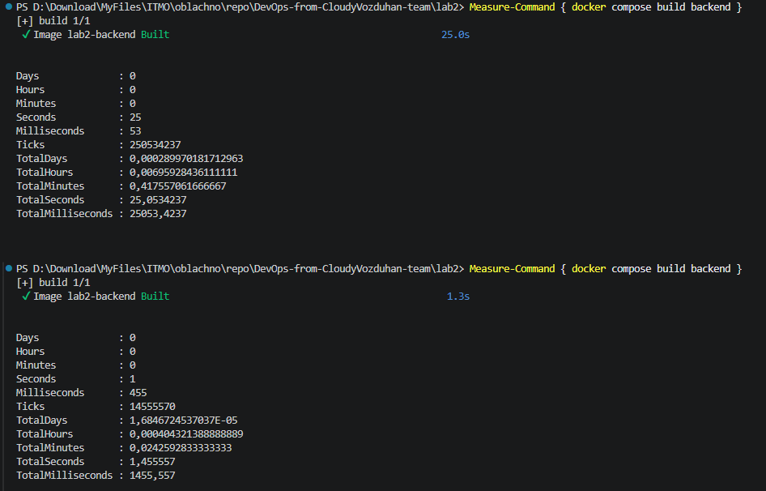
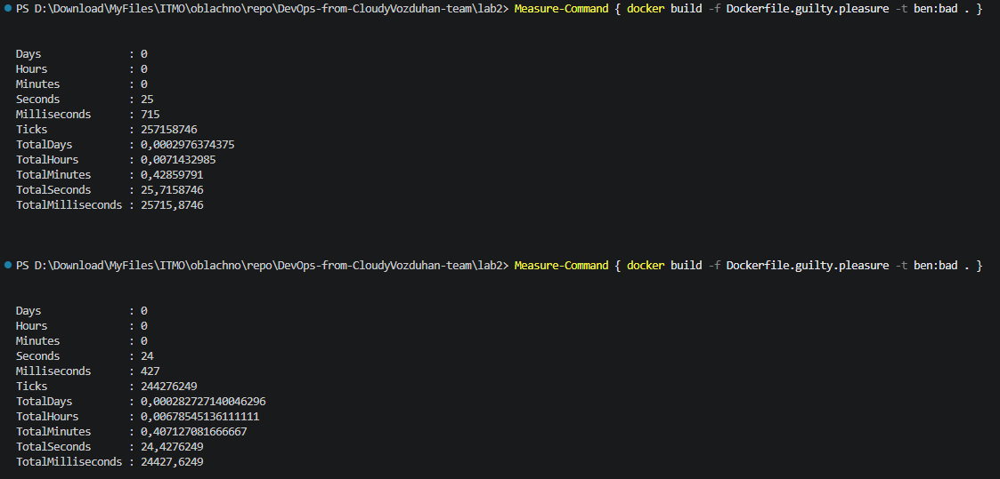


Теперь проверим сохранение данных в именованный том. Создадим тестовую таблицу в бд и запишем туда строку данных. Потом удалим контейнер с базой и поднимем его снова. Видим, что наша строка сохранилась в бд.

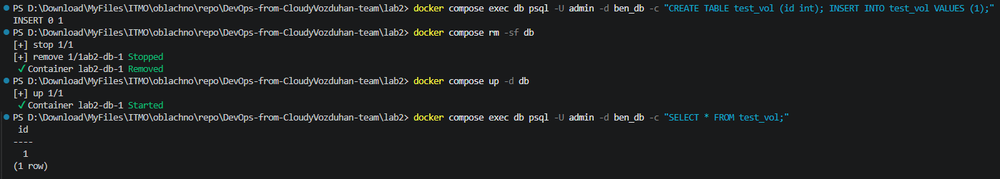


## Звездочка *

### Самовосстановление
Реализация самовосстановления описана в docker-compose.yaml. Для контейнеров бд и бэка установлены ```restart: unless-stopped```, что означает, что докер будет перезапускать контейнер, если он упадет. У бэкенда есть параметры в ```depends_on```, которые означают, что бэк не будет запущен, пока не запустится контейнер с базой данных. Прописываем HEALTHCHECK в хорошем образе и в compose для базы данных, чтобы докер мог определять состояние контейнера (на фронте стоит nginx, он очень стабильный).

Проверим работоспособность. Сначала видим, что у нас запущено 3 контейнера. Теперь убиваем контейнер с бд и видим, что осталось два контейнера, но бэк продолжает работать. Так произошло из-за особенностей работы docker на windows. На самом деле все сработало правильно, заглянем в логи контейнера бд. В четвертой строке видим падение контейнера и в пятой строке уже происходит перезапуск контейнера через 0.3 секунды после падения. Это доказывает работу самовосстановления.

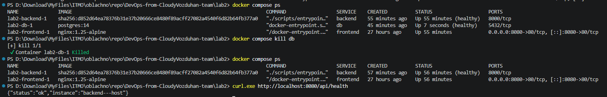
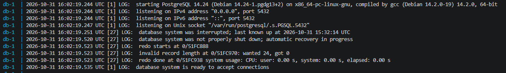


### Лимиты под нагрузкой

Лимиты установили в контейнерах бд и бэка. Для базовой части были установлены 0.5 CPU и 256Мб памяти. При переполнении памяти контейнер ловит ООМ и автоматически убивается и перезапускается, при недостаточности процессора ловим троттлинг - принудительное ограничение процессорного времени работы контейнера.  

Попробуем сначала поймать ООМ. Установим значения CPU 0.5, память 32 Мб, пересоберем бэкенд. Запустим просмотр статистики и дадим нагрузку на сервер ```1..2000 | % { curl.exe -s http://localhost:8080/api/health > $null }```. Память начинает переполняться, в логах видим перезапуск контейнера с кодом 137 (ООМ).

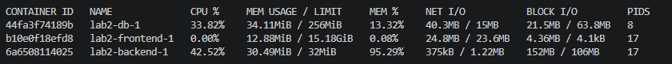
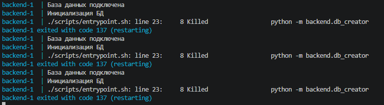

Теперь перезапустим с CPU 0.01, память 256 Мб. Дадим нагрузку и посмотрим количество троттлингов. Их количество растет (строка nr_throttled), контейнер принудительно ограничивается.

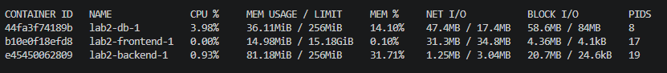
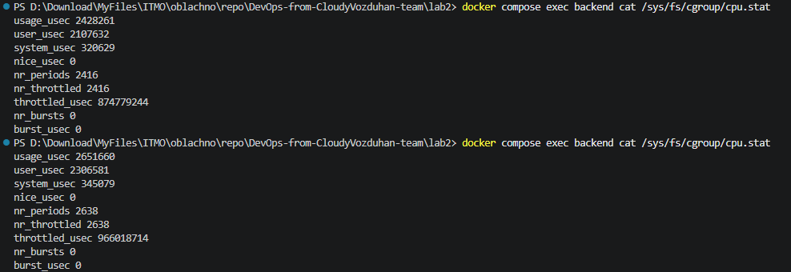


# Вывод

Эээ... Ну что-то я явно поняла... 

Поняла, как надо писать образы докера, что он не такой страшный, оказывается.. Собрала docker-compose, который упаковал все приложение по контейнерам, и оно даже заработало, я в восторге. Не знаю, зачем решила помучиться с отдельным контейнером с nginx, в котором сама же и забыла прописать пару путей, и потом сама же и мучилась, почему не работает... развлекалово полнейшее. Но в принципе не зря, тоже что-то поняла. В звездочках было странно пытаться разобраться, почему вдруг ничего не выводится в ps, а это просто приколы винды оказывается. В общем, мое погружение прошло не зря, я даже открыла и почитала такие забытые вещи как хабр, прониклась, поностальгировала, прослезилась... Да и вообще лабы очень крутые, спасибо вам, реально полезные вещи, я фанатка.